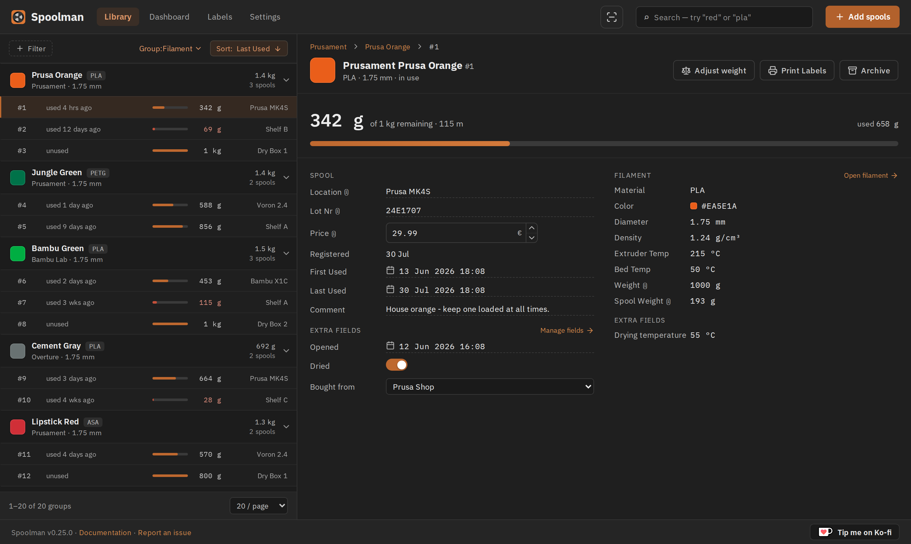
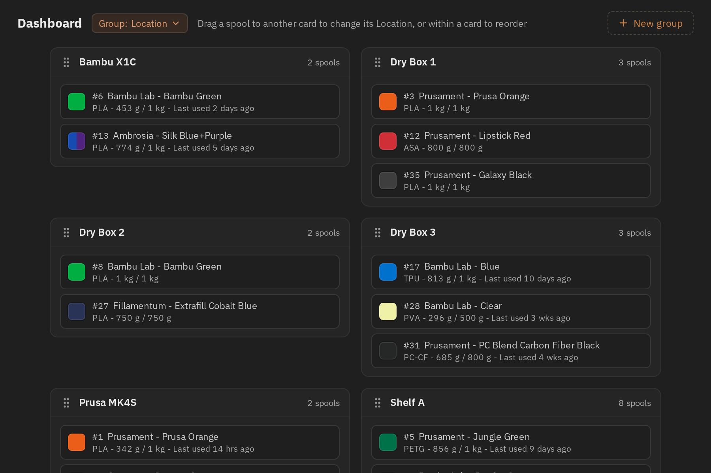
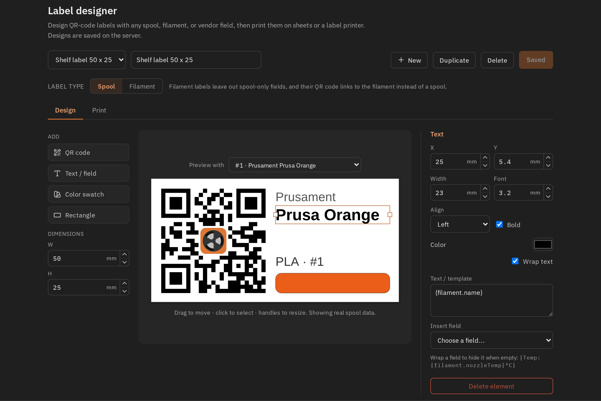

  

 

_Keep track of your inventory of 3D-printer filament spools._

> **Note:** This is a fork of [Spoolman by Donkie](https://github.com/Donkie/Spoolman). All credit for the original project goes to [Donkie](https://github.com/Donkie).

Spoolman is a self-hosted web service designed to help you efficiently manage your 3D printer filament spools and monitor their usage. It acts as a centralized database that seamlessly integrates with popular 3D printing software like [OctoPrint](https://octoprint.org/) and [Klipper](https://www.klipper3d.org/)/[Moonraker](https://moonraker.readthedocs.io/en/latest/). When connected, it automatically updates spool weights as printing progresses, giving you real-time insights into filament usage.

### Features
* **Filament Management**: Keep comprehensive records of filament types, manufacturers, and individual spools.
* **API Integration**: The [REST API](https://olyforge3d.github.io/Spoolman/) allows easy integration with other software, facilitating automated workflows and data exchange.
* **Real-Time Updates**: Stay informed with live spool updates through Websockets, providing immediate feedback during printing operations.
* **Central Filament Database**: A community-supported database of manufacturers and filaments simplify adding new spools to your inventory. Contribute by heading to [SpoolmanDB](https://github.com/OlyForge3D/SpoolmanDB).
* **Web-Based Client**: Spoolman includes a built-in web client that lets you manage data effortlessly:
  * View, create, edit, and delete filament data.
  * Search, group and filter your inventory by manufacturer, material, location and more.
  * Add custom fields to tailor information to your specific needs.
  * Design and print labels with QR codes for easy spool identification and tracking.
  * Contribute to its translation into 18 languages via [Weblate](https://hosted.weblate.org/projects/spoolman/).
* **Database Support**: SQLite, PostgreSQL, MySQL, and CockroachDB.
* **Platform Support**: Docker images available for `linux/amd64` and `linux/arm64`. (Note: `armv7` is not supported.)
* **Multi-Printer Management**: Handles spool updates from several printers simultaneously.
* **Advanced Monitoring**: Integrate with [Prometheus](https://prometheus.io/) for detailed historical analysis of filament usage, helping you track and optimize your printing processes. See the [Wiki](https://github.com/OlyForge3D/Spoolman/wiki/Filament-Usage-History) for instructions on how to set it up.

**Spoolman integrates with:**
  * [Moonraker](https://moonraker.readthedocs.io/en/latest/configuration/#spoolman) and most front-ends (Fluidd, KlipperScreen, Mainsail, ...)
  * [OctoPrint](https://github.com/mdziekon/octoprint-spoolman)
  * [OctoEverywhere](https://octoeverywhere.com/spoolman?source=github_spoolman)
  * [Home Assistant](https://github.com/Disane87/spoolman-homeassistant)
  * [MCP Server](https://github.com/Disane87/spoolman-mcp) - Manage your filament inventory through AI assistants like Claude using the Model Context Protocol

**Web client preview:**

<table>
  <tr>
    <td width="50%"></td>
    <td width="50%"></td>
  </tr>
  <tr>
    <td align="center">Dashboard — spools as cards, grouped by location or any other field. Drag one to move it.</td>
    <td align="center">Label designer — QR labels built from any spool, filament or vendor field.</td>
  </tr>
</table>

## Installation
Please see the [Installation page on the Wiki](https://github.com/OlyForge3D/Spoolman/wiki/Installation) for details how to install Spoolman.

If the new client misbehaves on your setup, set `SPOOLMAN_LEGACY_CLIENT=TRUE` to go back to
the previous one. Both ship in every release and talk to the same API, so your data is
untouched either way — but please [report the problem](https://github.com/OlyForge3D/Spoolman/issues)
so it can be fixed.

## NFC reader integration

`POST /api/v1/tag/scan` with `{"uid":"E0040108662F6FBC"}` performs UID lookup without
changing inventory. `matched_spool_id` and `matched_filament_id` are always present;
both are null for an unknown tag. A matched spool or filament is embedded in the response.
Link explicitly with `POST /api/v1/spool/{id}/tag` or
`POST /api/v1/filament/{id}/tag` and `{"uid":"..."}`. Unlink with
`DELETE /api/v1/spool/{id}/tag/{uid}` or the corresponding filament route.
Links persist in the database, not the ephemeral reader registry.

UIDs are uppercase hex without separators. Case, separators and an optional `0x` prefix
are normalized, but **byte order is preserved**. ISO15693/NFC-V clients must submit the
eight-byte UID MSB first (`E0` first), consistently across scan, link and unlink.
CoreNFC's displayed ISO15693 identifier uses this order; an adapter whose reader returns
wire-order bytes must reverse them before sending. Do not retry lookup using both orders:
they are distinct database keys, and existing links are not migrated automatically.

Linking the same UID to the same target is idempotent (201). Linking it to a different
target returns 409 and the current `spool_id` or `filament_id`; it never silently moves
the tag. Unlink the existing owner explicitly before linking elsewhere. Invalid hex or
odd-length UIDs return 400; missing/empty/oversized request fields return 422.

### OpenPrintTag payload enrichment

For genuine [OpenPrintTag](https://specs.openprinttag.org), send `format: "openprinttag"`
and `payload_b64` containing either:

* The **CBOR payload** of the `application/vnd.openprinttag` MIME NDEF record, beginning
  with its meta map followed by the main/optional auxiliary regions. This is the CoreNFC
  integration contract: the client must select the exact MIME media record before
  forwarding its payload.
* The existing **full NFC-V memory image**, including the `E1` capability container,
  NDEF TLV, and MIME NDEF record.

A serialized NDEF message without its capability container is not a memory image and is
not accepted as either representation. JSON text records previously called "OpenPrintTag"
are not the OpenPrintTag format; clients can retain legacy reads, but must not label JSON
as genuine MIME/CBOR when writing new tags.

Successful decoding adds `decoded` fields to the scan response. Unknown formats, malformed
base64/CBOR, truncated memory and unsupported records leave enrichment absent, **without
preventing UID lookup**. Decoding never updates an existing linked spool or filament.
Only explicit `create: true` may create a spool from an unlinked, decodable FFF tag;
repeated scans of an already linked UID never duplicate or reassign inventory.
An instance UUID in the tag takes precedence; otherwise its UID derives the UUID specified
by OpenPrintTag (for `E0040108662F6FBC`: `bf63e92d-9ca5-53d7-9fab-ffdd0240c585`).

Interoperability is pinned to official specification source
[`060e420892d66c062c8af440c97701aab96bac79`](https://github.com/OpenPrintTag/openprinttag-specification/tree/060e420892d66c062c8af440c97701aab96bac79).
The spec intentionally has no on-wire version field: backwards-incompatible formats require
a different MIME type. Field keys unknown to Spoolman are ignored; no physical tag-writing
or encoding endpoint is provided. Run the isolated backend evidence with
`uv run pytest tests/test_tag_contract.py tests/test_openprinttag_codec.py tests/test_tag_decode.py`.
These software fixtures do not substitute for an iPhone/reader round trip on real NFC-V hardware.
